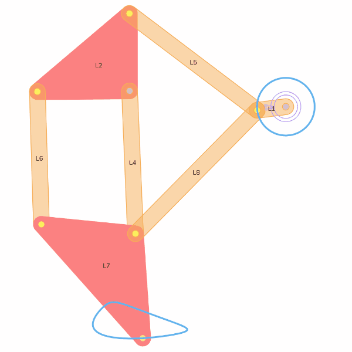
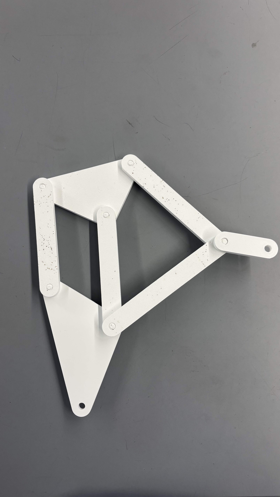
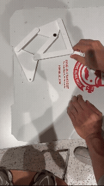
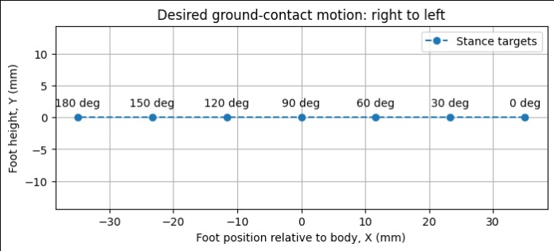
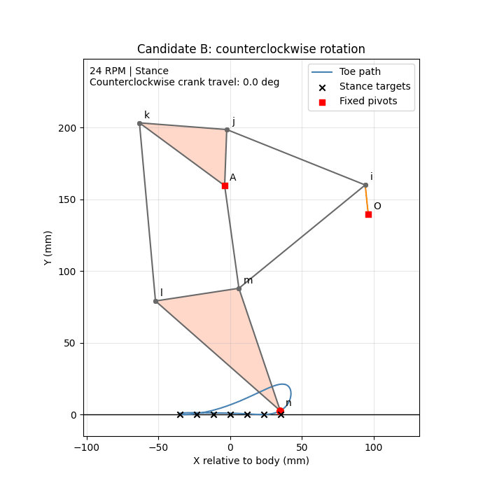

# ME-350R-Project

Members: Anastasiia Brund, Peter Nguyen, Pablo Pena

### A walking robot designed to deliver food and beverages using a linkage-driven locomotion mechanism and an onboard tray.

## Project Track: Legs and Locomotion

## Overview
Our goal is to build a robotic waiter that can carry snacks and drinks to a user. The proposed robot combines a walking mechanism with a tray mounted above the chassis, with an emphasis on smooth, stable motion to reduce spills and keep the payload secure.
The primary control mode will be remote control. As an extension, we plan to add computer vision so the robot can respond to a user's hand wave and move toward them.

[BOM](https://docs.google.com/spreadsheets/d/16ZARARR6a1qfLJMSYsjxh-cHdoF95DUiiNxAMhKOWgo/edit?usp=sharing)

### Initial Jansen Linkage Simulation

### Initial Jansen Linkage 3D Print

### Initial Jansen Linkage 3D Print Motion Test

We initially printed with PETG to physically validate the proof of concept. We needed a way to ground the link during the motion test. Coincidentally, we found a  pizza box outside, which was perfect for testing (perfect for the theme of a food delivery robot, no?). The joints were a bit stiff during testing due to some incorrect tolerancing issues with the 3D-printed pin joints, and our input crank didn't yield perfectly controlled motion since the user would manually turn the crank, attempting to approximate circular motion.

### Python Synthesis

Moving from this, we created a Python optimization program that takes my starting dimensions and adjusts the link lengths so the foot hits seven target points along a 70 mm stance, while also keeping the joint angles in a range where the mechanism won’t bind. It brought the path error from the initial design down from about 7 mm to under 2 mm.

