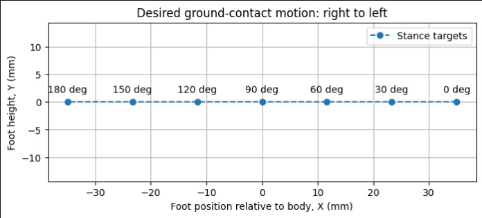
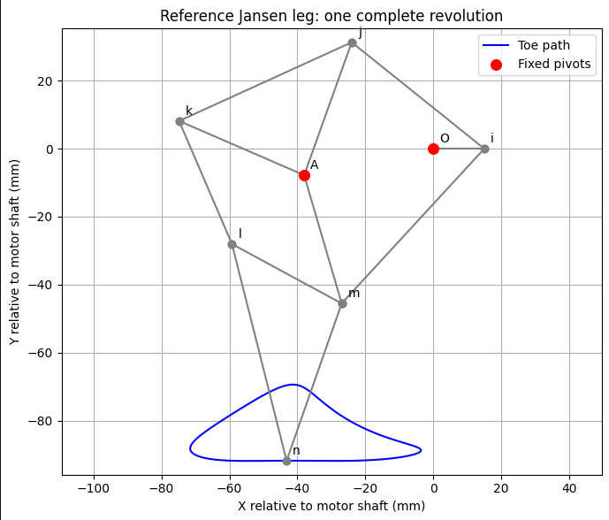
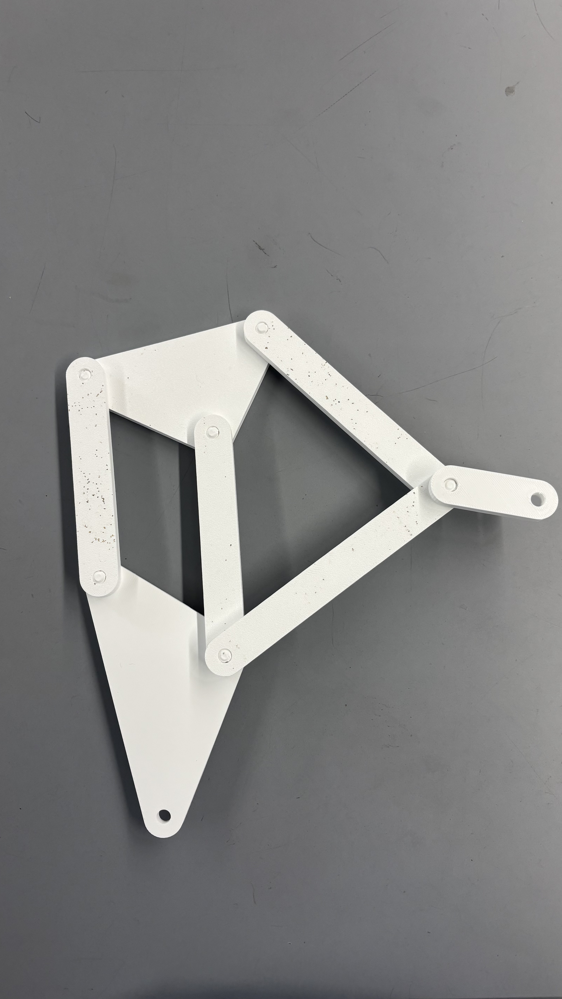

# ME-350R-Project

Members: Anastasiia Brund, Peter Nguyen, Pablo Pena

### A walking robot designed to deliver food and beverages using a linkage-driven locomotion mechanism and an onboard tray.

## Project Track: Legs and Locomotion

## Overview
Our goal is to build a robotic waiter that can carry snacks and drinks to a user. The proposed robot combines a walking mechanism with a tray mounted above the chassis, with an emphasis on smooth, stable motion to reduce spills and keep the payload secure.
The primary control mode will be remote control. As an extension, we plan to add computer vision so the robot can respond to a user's hand wave and move toward them.

[BOM](https://docs.google.com/spreadsheets/d/16ZARARR6a1qfLJMSYsjxh-cHdoF95DUiiNxAMhKOWgo/edit?usp=sharing)

### Initial Jansen Linkage Simulation

### Python Synthesis

### Initial Jansen Linkage 3D Print

Initially printed with PETG to serve as a physical verification of the proof of concept
